# Fase 1: Setup Environment

[← README](README.md) | [Fase 2: Backend Laravel →](02-backend-laravel.md)

---

## 1.1 Struktur folder

- **Masalah:** frontend dan backend aku taruh di satu repo, jadi butuh struktur yang jelas sebelum nulis kode.
- **Pengerjaan:**
  - Bikin `backend/`, `frontend/`, `docker/`, dan `docs/` (isinya `screenshots/` per fase dan `notes/`) pakai `mkdir -p`.
  - `backend/` dan `frontend/` sengaja aku kosongin karena Laravel dan Vite yang bakal ngisinya.
  - Awalnya aku sempat mau bikin subfolder Laravel manual dan bikin `docker-compose.yml` pakai `mkdir`. Dua-duanya salah (yang kedua bakal jadi folder, bukan file), dan udah dibenerin sebelum dijalanin.
- **Hasil:** struktur terbentuk dan dicek pakai `tree`.
- **Kesimpulan:** nentuin struktur di awal bikin lokasi file dan screenshot konsisten sampai project selesai.

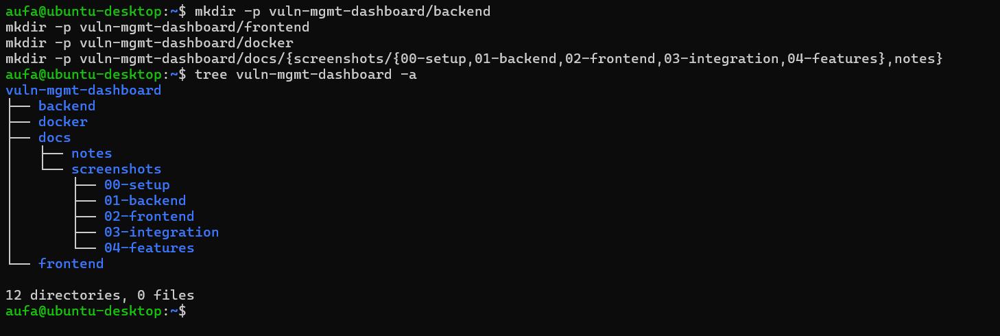

---

## 1.2 Install Docker Engine dari repository resmi

- **Masalah:** paket `docker.io` dari repo Ubuntu versinya ketinggalan dan belum tentu ada `docker-compose-plugin`, padahal aku butuh `docker compose`.
- **Pengerjaan:**
  - Install dependency dulu: `ca-certificates`, `curl`, `gnupg`.
  - Download GPG key Docker, simpan di `/etc/apt/keyrings`, lalu bikin source list yang nunjuk ke key itu lewat `signed-by`.
  - Baru install `docker-ce`, `docker-ce-cli`, `containerd.io`, dan dua plugin (buildx dan compose).
- **Hasil:** Docker 29.6.2 dan Compose v5.3.1 terpasang, service `docker` statusnya `active (running)`.
- **Kesimpulan:** paket diinstall dari sumber yang signature-nya bisa diverifikasi, bukan dari repo default.

```bash
sudo install -m 0755 -d /etc/apt/keyrings
curl -fsSL https://download.docker.com/linux/ubuntu/gpg | sudo gpg --dearmor -o /etc/apt/keyrings/docker.gpg
sudo chmod a+r /etc/apt/keyrings/docker.gpg

echo "deb [arch=$(dpkg --print-architecture) signed-by=/etc/apt/keyrings/docker.gpg] https://download.docker.com/linux/ubuntu $(. /etc/os-release && echo "$VERSION_CODENAME") stable" | sudo tee /etc/apt/sources.list.d/docker.list > /dev/null

sudo apt update
sudo apt install -y docker-ce docker-ce-cli containerd.io docker-buildx-plugin docker-compose-plugin
```

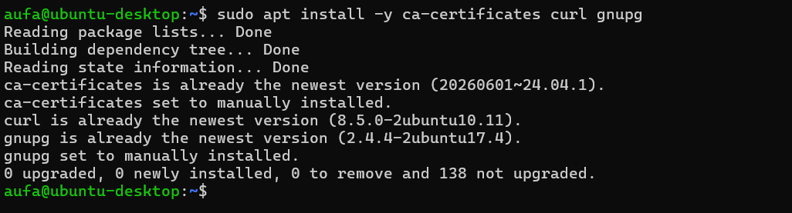

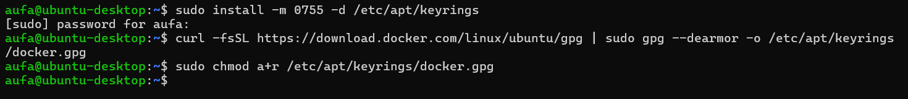

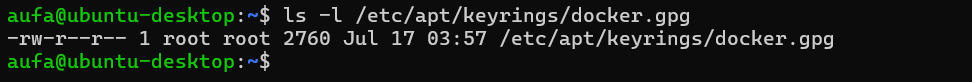

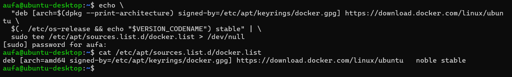

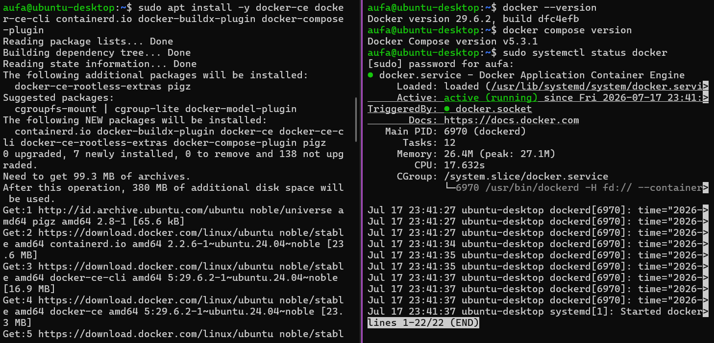

---

## 1.3 Docker tanpa sudo

- **Masalah:** tiap perintah `docker` minta `sudo`.
- **Pengerjaan:**
  - Tambahin user ke grup `docker` pakai `usermod -aG docker $USER`, lalu logout dan login lagi.
  - Di terminal lama `docker compose up` masih kena `permission denied` karena grupnya belum kebaca. `groups` nunjukin `docker` belum ada, dan `newgrp docker` yang nyelesaiin.
- **Hasil:** `docker ps` jalan tanpa `sudo`.
- **Kesimpulan:** anggota grup `docker` praktisnya setara root di host. Buat VM dev pribadi ini aku terima, tapi ga bakal aku pakai di server bersama.

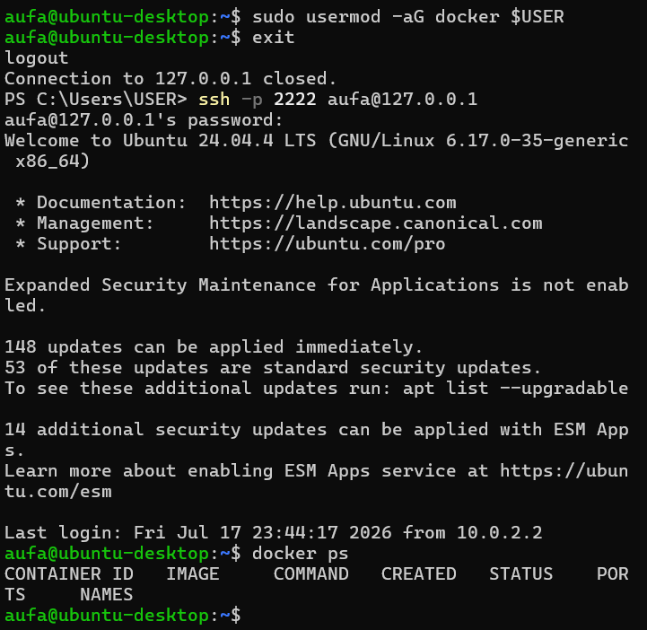

---

## 1.4 MySQL dan phpMyAdmin pakai Docker Compose

- **Masalah:** aku mau database yang gampang di-reset dan ga nempel ke sistem VM.
- **Pengerjaan:**
  - Dua service di satu `docker-compose.yml`: `mysql:8.0` dan `phpmyadmin:5.2`. Versinya aku pin, ga pakai `latest`, biar ga berubah diam-diam.
  - Data MySQL pakai bind mount ke `docker/mysql-data/` supaya isinya bisa aku lihat langsung dan tetap ada walau container dihapus.
  - Aplikasi nanti konek lewat user `vulnapp`, bukan `root`.
- **Temuan:** pull image MySQL makan sekitar 34 menit dan bandwidth yang kepake jauh lebih gede dari ukuran image-nya, padahal `ping` stabil dan 0% loss. Dugaanku ada di adapter jaringan VM (VirtualBox NAT dengan Intel PRO/1000), tapi ini cuma dugaan. Prosesnya akhirnya selesai sendiri dan ga sempat aku buktiin.
- **Hasil:** kedua container `Up`, login ke MySQL pakai `vulnapp` berhasil, dan database `vuln_mgmt` kebentuk otomatis dari `MYSQL_DATABASE`.
- **Kesimpulan:** database sekarang bisa dibuang dan dibuat ulang tanpa nyentuh sistem VM.

```yaml
services:
  mysql:
    image: mysql:8.0
    container_name: vuln-mgmt-mysql
    restart: unless-stopped
    environment:
      MYSQL_DATABASE: vuln_mgmt
      MYSQL_USER: vulnapp
      MYSQL_PASSWORD: <REDACTED>
      MYSQL_ROOT_PASSWORD: <REDACTED>
    ports:
      - "3306:3306"
    volumes:
      - ./mysql-data:/var/lib/mysql

  phpmyadmin:
    image: phpmyadmin:5.2
    container_name: vuln-mgmt-phpmyadmin
    restart: unless-stopped
    environment:
      PMA_HOST: mysql
      PMA_USER: root
      PMA_PASSWORD: <REDACTED>
    ports:
      - "8081:80"
    depends_on:
      - mysql
```

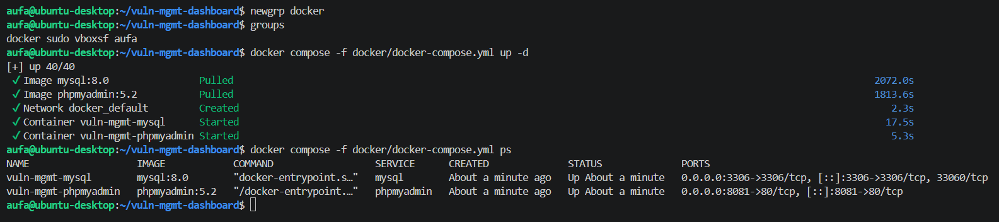

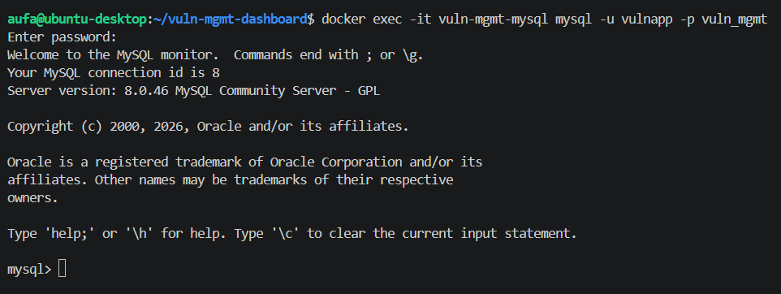

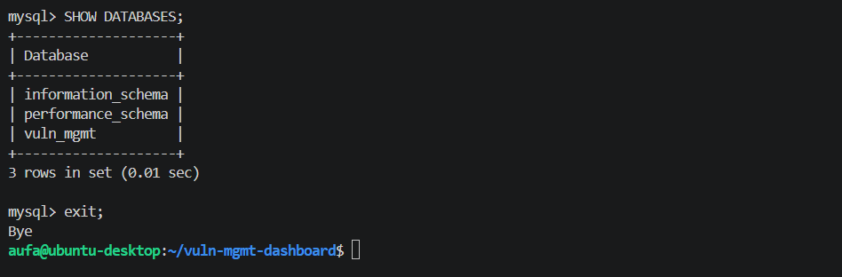

---

## 1.5 Akses phpMyAdmin dari Windows

- **Masalah:** phpMyAdmin udah jalan di VM, tapi browser di Windows ga bisa buka `127.0.0.1:8081`.
- **Investigasi:**
  - `ip a` buat mapping interface VM: NAT, internal network, `docker0`, bridge compose, dan dua `veth` (satu per container).
  - `curl -I http://localhost:8081` dari dalam VM balikin `200 OK`, jadi container-nya sehat.
  - `Test-NetConnection` dari Windows buat ngecek jalurnya dari sisi host.
- **Temuan:** port SSH (2222) udah ke-forward dari project sebelumnya, tapi port 8081 belum punya rule sendiri di VirtualBox NAT.
- **Pengerjaan:** tambah rule port forwarding 8081 ke 8081, lalu restart VM.
- **Hasil:** phpMyAdmin kebuka dari Windows. Di browser biasa sempat masih gagal, sementara di incognito langsung jalan, dan tak lama setelah itu browser biasa juga jalan. Penyebab pastinya ga ketemu.
- **Kesimpulan:** ngecek per layer (container, VM, host) lebih cepat daripada langsung nyalahin satu komponen.

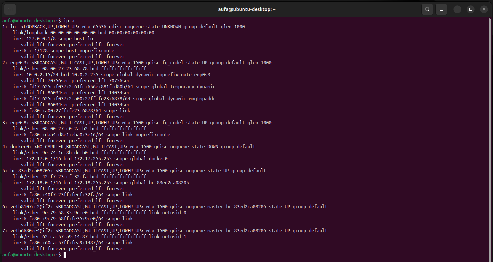

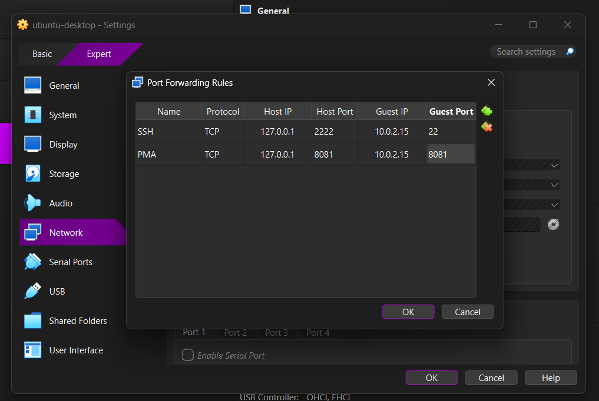

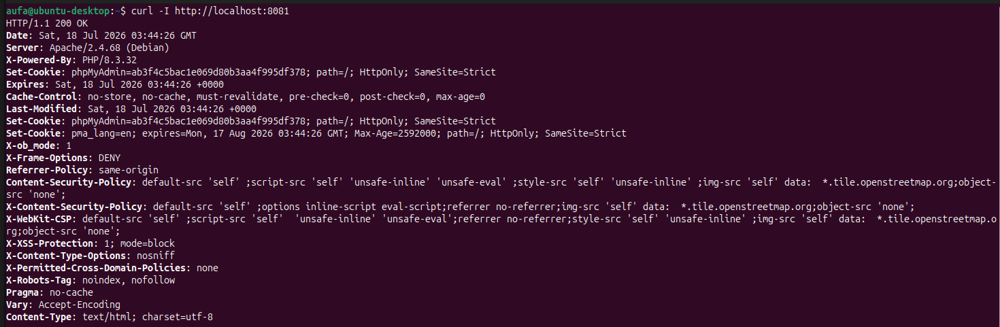

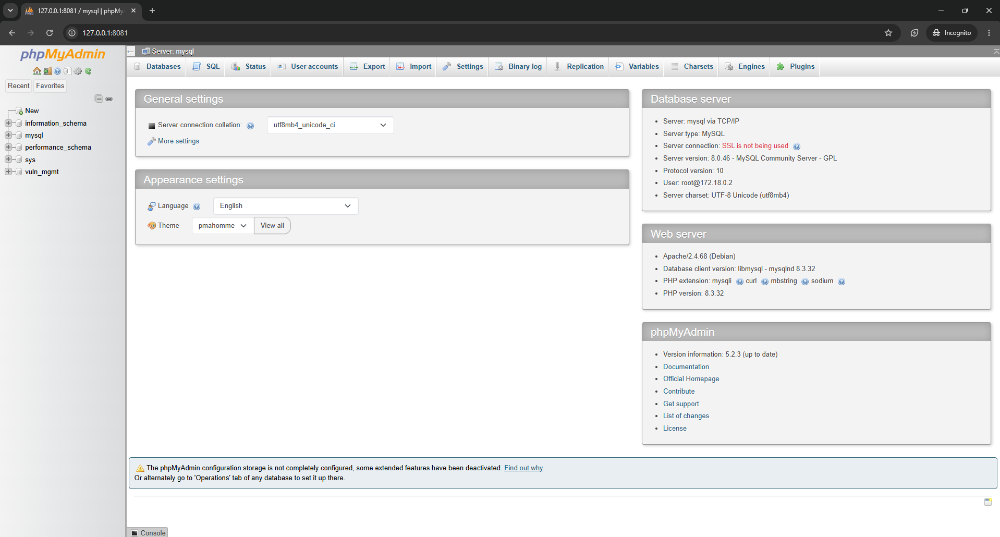

---

[← README](README.md) | [Fase 2: Backend Laravel →](02-backend-laravel.md)
