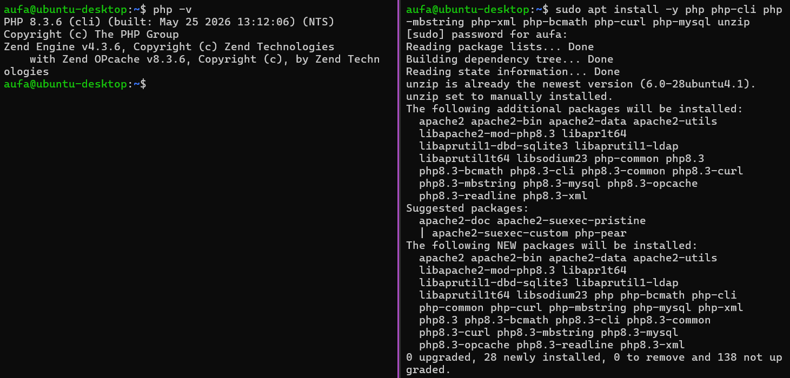
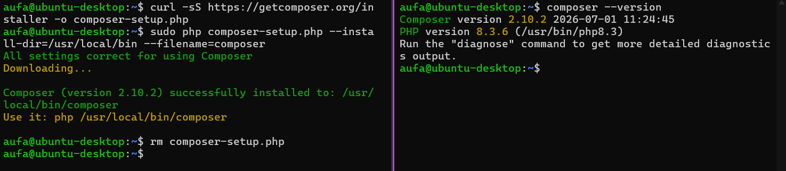
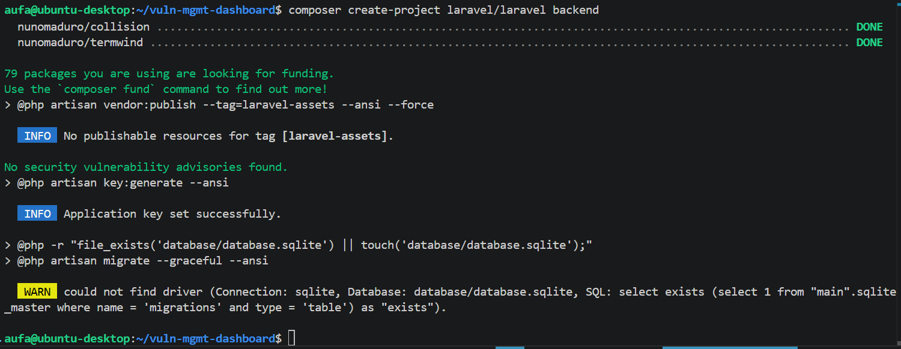
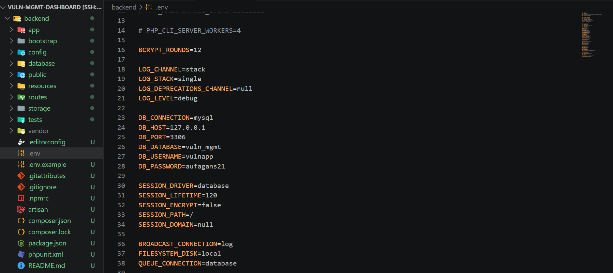
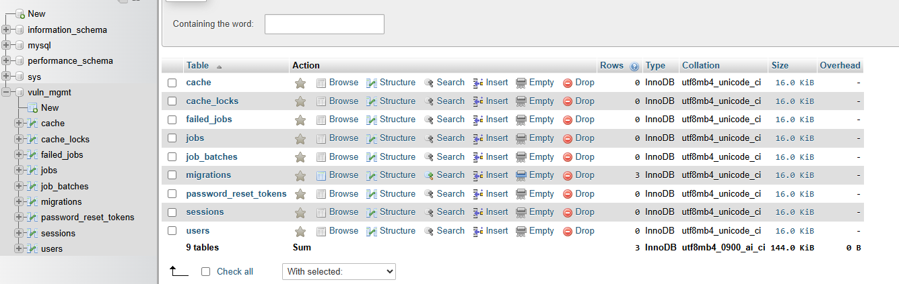
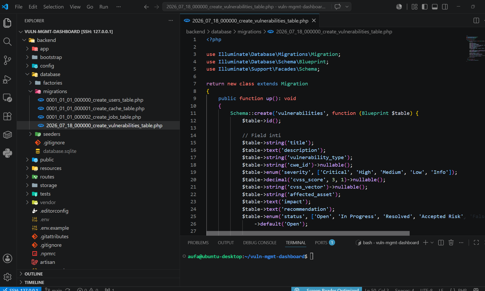
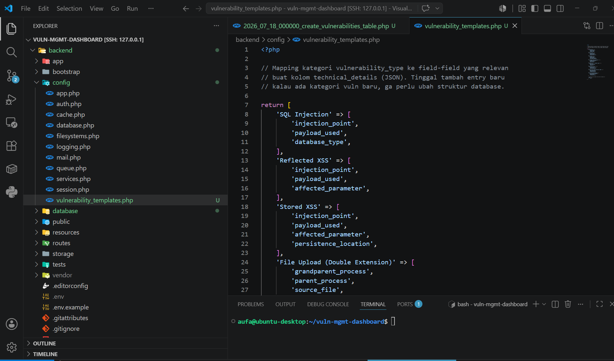
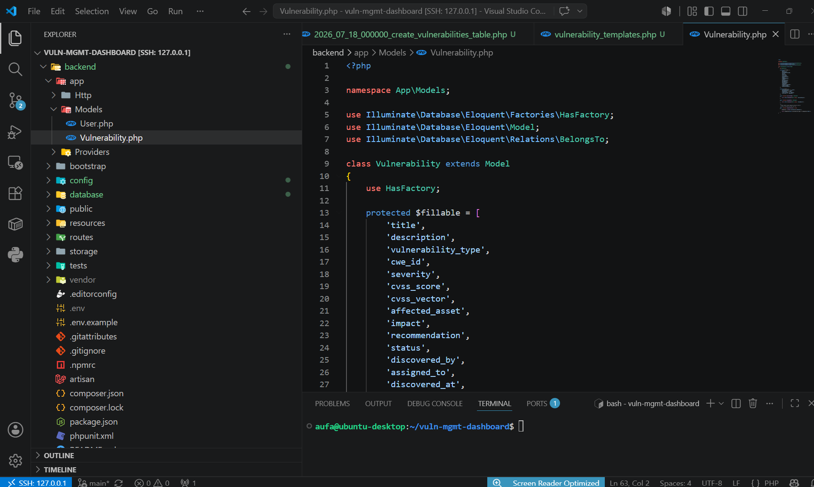
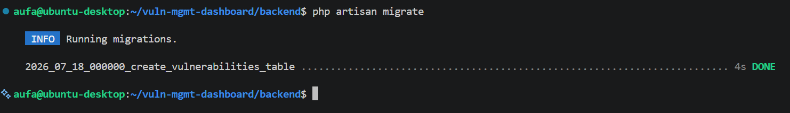

# Fase 2: Backend Laravel

[← Fase 1: Setup Environment](01-setup-environment.md) | [README](README.md) | [Fase 3: REST API →](03-rest-api.md)

---

## 2.1 PHP dan Composer

- **Masalah:** Laravel butuh PHP, dan instalasinya jalan lewat Composer. Di VM belum ada keduanya.
- **Pengerjaan:**
  - Install PHP 8.3 plus ekstensi `mbstring`, `xml`, `bcmath`, `curl`, `mysql`, dan `unzip`.
  - Composer dipasang dari installer resmi ke `/usr/local/bin` supaya bisa dipanggil dari folder mana pun.
  - Paket `php` ikut narik Apache2 sebagai dependency. Ga kepake, karena aku jalanin Laravel pakai `php artisan serve`.
- **Hasil:** PHP 8.3.6 dan Composer 2.10.2.
- **Kesimpulan:** `php-mysql` ekstensi yang paling penting di sini, karena tanpa itu Laravel ga bisa konek ke MySQL.





---

## 2.2 Install Laravel

- **Pengerjaan:** `composer create-project laravel/laravel backend`, dijalanin dari root repo (bukan dari dalam `backend/`, biar ga jadi `backend/backend/`).
- **Temuan:** di akhir instalasi muncul warning driver SQLite ga ketemu. Itu wajar, karena default database Laravel masih SQLite dan `.env` belum aku arahkan ke MySQL.
- **Hasil:** struktur Laravel kebentuk di `backend/`.



---

## 2.3 Konek ke MySQL

- **Masalah:** `.env` bawaan masih nunjuk SQLite.
- **Pengerjaan:** ubah blok `DB_*` jadi MySQL. Aku sempat nambah blok `DB_CONNECTION` kedua di bawah file. Itu berisiko karena dotenv ga nimpa nilai yang udah ada, jadi yang dibaca tetap yang pertama (SQLite). Makanya blok aslinya yang diedit.
- **Hasil:** `php artisan migrate` bikin tabel default Laravel, dan tabelnya kelihatan di phpMyAdmin.
- **Kesimpulan:** koneksi Laravel ke MySQL di Docker udah kebukti dari dua sisi, CLI dan GUI.

```env
DB_CONNECTION=mysql
DB_HOST=127.0.0.1
DB_PORT=3306
DB_DATABASE=vuln_mgmt
DB_USERNAME=vulnapp
DB_PASSWORD=<REDACTED>
```






---

## 2.4 Skema data vulnerability

- **Masalah:** field bukti teknis beda di tiap jenis vuln. Double extension butuh rantai proses (grandparent, parent, source), sedangkan credential leak butuh source IP dan waktu login. Kalau semuanya dijadiin kolom, banyak yang kosong. Kalau tiap jenis baru butuh migration, ribet.
- **Pengerjaan:**
  - Kebutuhan dan ide pemetaan per kategori datang dari aku. Bentuk akhirnya: kolom inti yang selalu ada (title, description, type, CWE, severity, CVSS score dan vector, affected asset, impact, recommendation, status, discoverer, assignee, tanggal) ditambah satu kolom JSON `technical_details`.
  - Field apa yang dipakai di `technical_details` ditentukan mapping kategori di `config/vulnerability_templates.php`.
  - `discovered_by` dan `assigned_to` jadi foreign key ke tabel `users`.
- **Hasil:** tabel `vulnerabilities` kebentuk. Nambah kategori baru cukup nambah satu entry di mapping, tanpa migration.
- **Kesimpulan:** pola kolom inti plus JSON cocok buat data yang bagian intinya stabil tapi detailnya beda-beda.

```php
return [
    'SQL Injection' => ['injection_point', 'payload_used', 'database_type'],
    'Reflected XSS' => ['injection_point', 'payload_used', 'affected_parameter'],
    'File Upload (Double Extension)' => ['grandparent_process', 'parent_process', 'source_file'],
    'Credential Leak / Anonymous Login' => ['source_ip', 'login_timestamp', 'leaked_via'],
    // ...
    'Other' => ['notes'],
];
```









---

[← Fase 1: Setup Environment](01-setup-environment.md) | [README](README.md) | [Fase 3: REST API →](03-rest-api.md)
