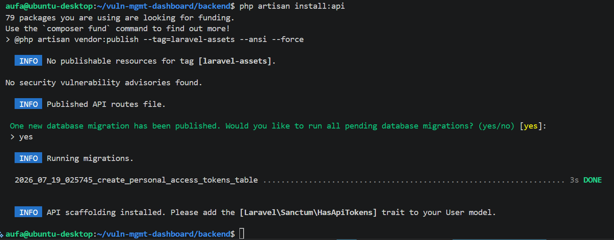
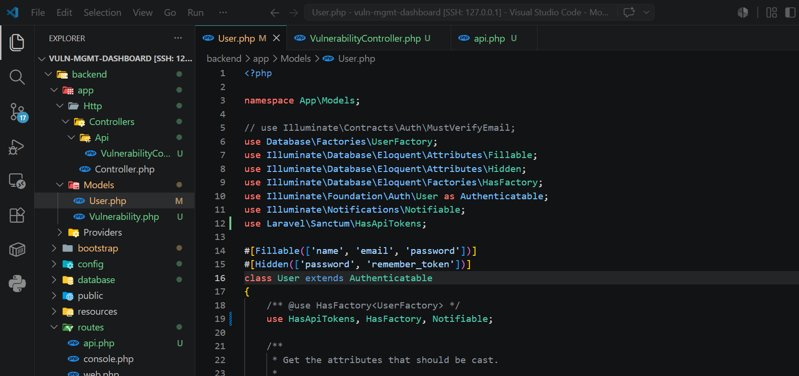
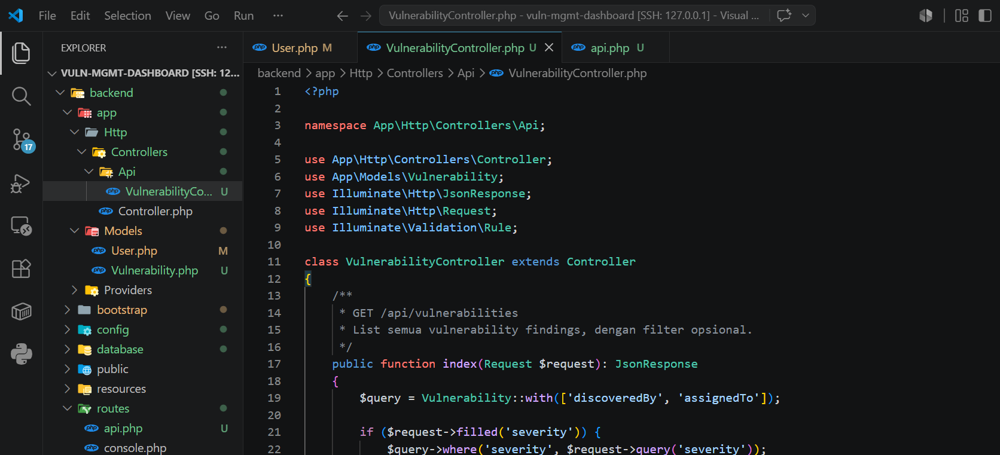
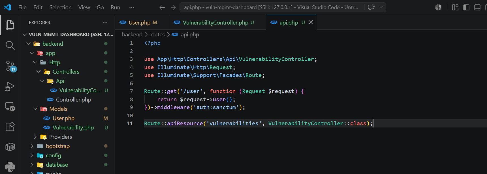
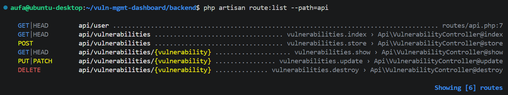
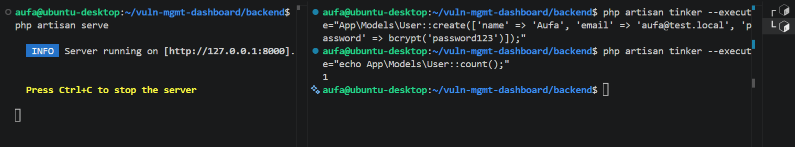
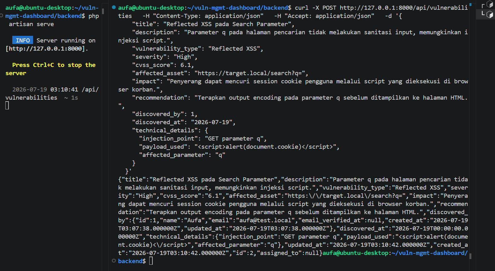
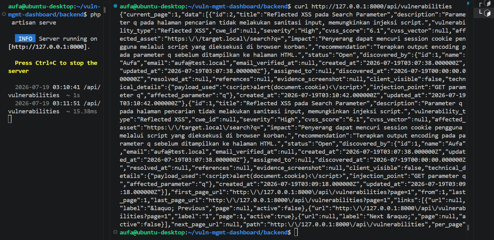

# Fase 3: REST API

[← Fase 2: Backend Laravel](02-backend-laravel.md) | [README](README.md) | [Fase 4: Frontend dan Dashboard →](04-frontend-dashboard.md)

---

## 3.1 API scaffolding dan Sanctum

- **Masalah:** Laravel versi baru ga langsung nyediain file routing API.
- **Pengerjaan:**
  - `php artisan install:api` bikin `routes/api.php`, install Sanctum, dan ngejalanin migration tabel token.
  - Tambah trait `HasApiTokens` di model `User`. File `User.php` di versiku udah pakai attribute `#[Fillable]`, jadi aku cuma nambah trait dan import-nya.
- **Hasil:** Sanctum terpasang dan tabel `personal_access_tokens` kebentuk.





---

## 3.2 Controller dan routes

- **Masalah:** frontend butuh cara baca, bikin, ubah, dan hapus temuan.
- **Pengerjaan:**
  - `VulnerabilityController` dengan lima action standar REST (`index`, `store`, `show`, `update`, `destroy`) dan satu `Route::apiResource`.
  - `severity` dan `status` dibatasi pakai `Rule::in()`, jadi API nolak nilai di luar daftar apa pun yang dikirim klien.
  - `with(['discoveredBy', 'assignedTo'])` supaya nama discoverer dan assignee ikut di response, tanpa request tambahan per baris.
  - Endpoint list bisa difilter lewat `?severity=` dan `?status=`.
- **Hasil:** `route:list` nunjukin semua route kedaftar.
- **Kesimpulan:** validasi sengaja ditaruh di server, karena dropdown di frontend bisa dilewati siapa pun yang manggil API langsung.

```php
public function store(Request $request): JsonResponse
{
    $validated = $request->validate([
        'severity' => ['required', Rule::in(['Critical', 'High', 'Medium', 'Low', 'Info'])],
        'status' => ['sometimes', Rule::in(['Open', 'In Progress', 'Resolved', 'Accepted Risk', 'False Positive'])],
        'discovered_by' => ['required', 'exists:users,id'],
        'technical_details' => ['nullable', 'array'],
        // ...
    ]);

    $vulnerability = Vulnerability::create($validated);

    return response()->json($vulnerability->load(['discoveredBy', 'assignedTo']), 201);
}
```







---

## 3.3 Tes pakai curl

- **Masalah:** aku mau mastiin API bener-bener jalan sebelum frontend ada, supaya kalau nanti ada error, aku tau sumbernya bukan di API.
- **Pengerjaan:**
  - Jalanin `php artisan serve`, lalu bikin satu user dummy lewat Tinker karena `discovered_by` wajib nunjuk ke user yang valid.
  - `POST` satu temuan Reflected XSS lengkap dengan `technical_details`, lalu `GET` buat ngambil lagi.
- **Hasil:** `POST` balikin `201` dengan relasi user ikut kebawa, dan `GET` nampilin data dengan struktur pagination Laravel.
- **Kesimpulan:** rantai Controller, Model, dan MySQL udah kebukti jalan sendiri.







---

[← Fase 2: Backend Laravel](02-backend-laravel.md) | [README](README.md) | [Fase 4: Frontend dan Dashboard →](04-frontend-dashboard.md)
