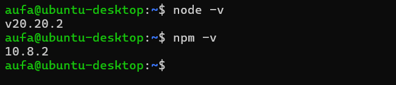
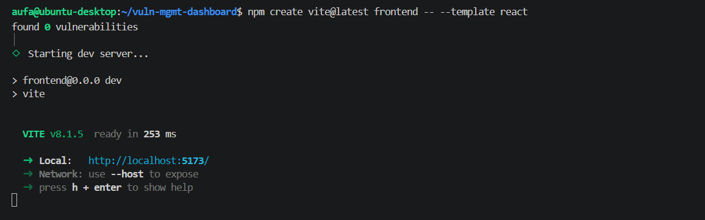
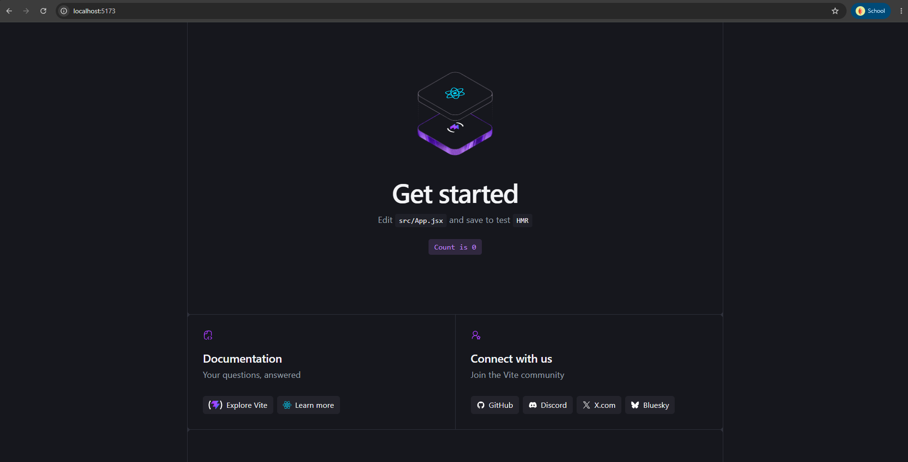
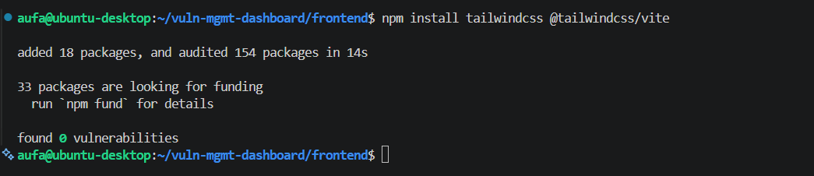
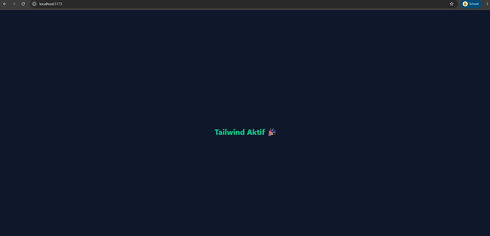
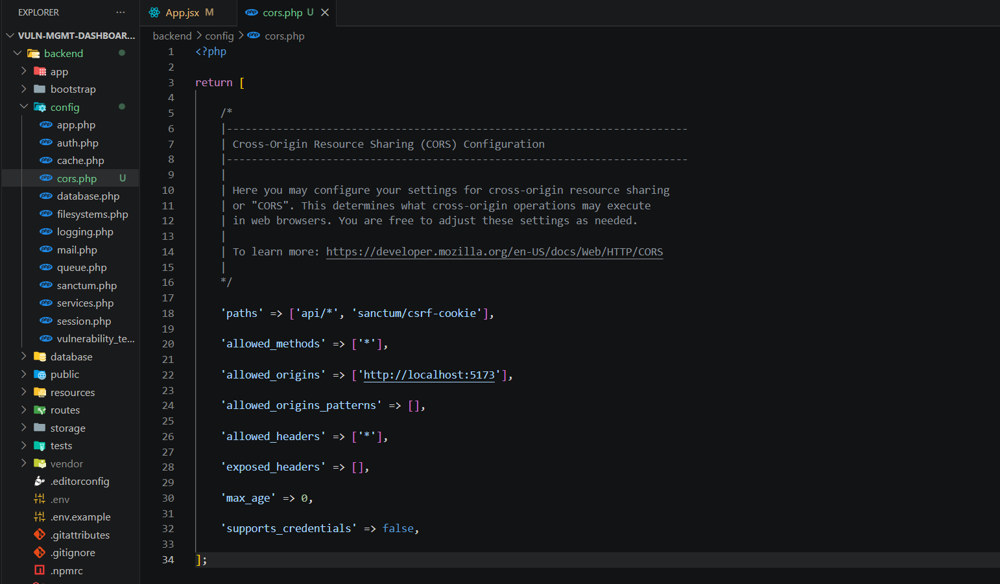
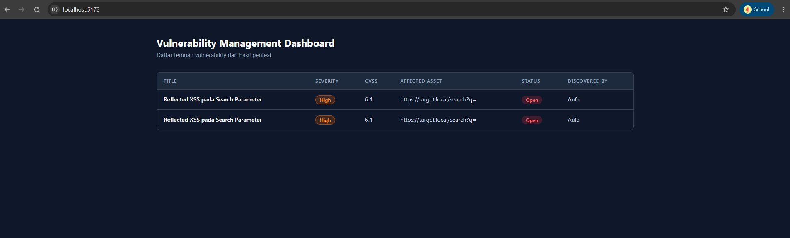

# Fase 4: Frontend dan Dashboard

[← Fase 3: REST API](03-rest-api.md) | [README](README.md) | [Fase 5: Autentikasi →](05-autentikasi.md)

---

## 4.1 Node, Vite, dan Tailwind

- **Masalah:** butuh app React yang gampang di-style dan bisa jalan bareng API.
- **Pengerjaan:**
  - Node 20.20.2 dan npm 10.8.2 ternyata udah ada dari project sebelumnya, jadi aku skip instalasi dan cuma ambil screenshot versinya.
  - Scaffold pakai `npm create vite@latest frontend -- --template react` dengan ESLint sebagai linter.
  - Tailwind CSS v4 lewat plugin `@tailwindcss/vite` dan satu baris `@import "tailwindcss";` di file CSS.
  - Sebelum bikin komponen asli, aku tes dulu pakai komponen sementara buat mastiin class Tailwind kepake.
- **Hasil:** dev server jalan di port 5173 dan styling Tailwind kebukti aktif.











---

## 4.2 CORS

- **Masalah:** React (port 5173) dan Laravel (port 8000) beda origin, jadi browser bakal nge-block request dari React sampai API-nya ngizinin.
- **Pengerjaan:** publish config pakai `php artisan config:publish cors`, lalu ganti `allowed_origins` dari wildcard bawaan jadi daftar eksplisit yang isinya cuma origin React dev server.
- **Hasil:** React bisa manggil API, dan origin lain ga diizinkan.
- **Kesimpulan:** wildcard paling bahaya kalau dipakai bareng cookie atau credential. Project ini pakai bearer token jadi risikonya lebih kecil, tapi allowlist tetap kebiasaan yang bagus dari awal.

```php
'allowed_origins' => ['http://localhost:5173'],
```



---

## 4.3 Tabel temuan

- **Masalah:** data dari API perlu ditampilin dengan cara yang gampang di-scan.
- **Pengerjaan:**
  - Fetch daftar temuan pas komponen pertama dimuat, lengkap dengan state loading dan error.
  - Tabel dengan badge warna buat severity dan status. Warnanya aku samain di tabel, modal, dan chart.
  - Klik baris buka modal detail yang nampilin semua field, termasuk `technical_details`.
  - Form input temuan ada tombol buka-tutup supaya dashboard ga langsung penuh. Field detail teknisnya ganti otomatis sesuai kategori yang dipilih.
- **Hasil:** tabel nampilin data hasil fetch dari API.



---

[← Fase 3: REST API](03-rest-api.md) | [README](README.md) | [Fase 5: Autentikasi →](05-autentikasi.md)
