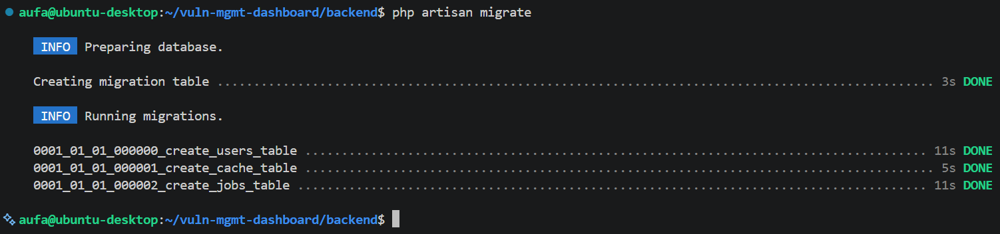
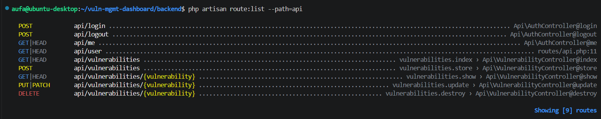
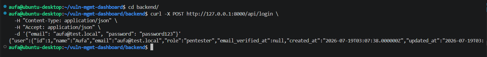
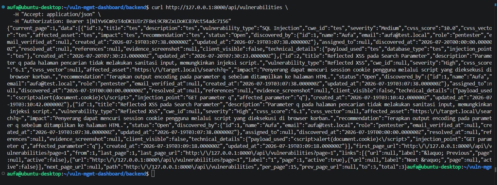
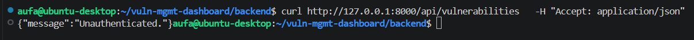
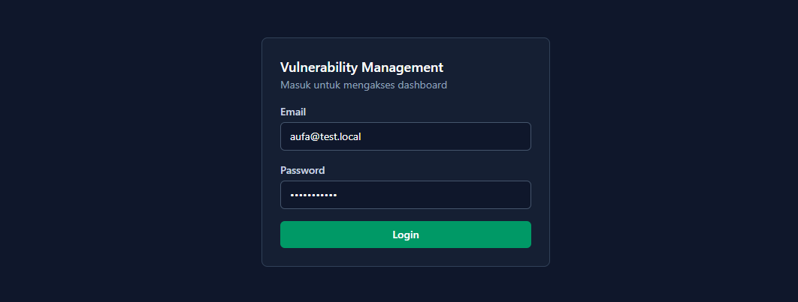
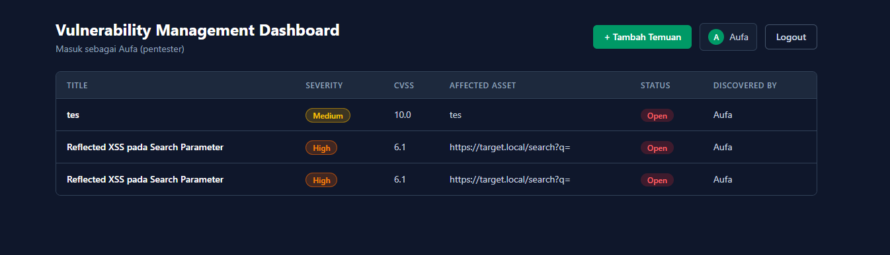

# Fase 5: Autentikasi

[← Fase 4: Frontend dan Dashboard](04-frontend-dashboard.md) | [README](README.md) | [Fase 6: Remediation, Chart, dan Data Contoh →](06-remediation-chart-data-contoh.md)

---

## 5.1 Kolom role

- **Masalah:** spesifikasi awal minta tiga jenis pengguna (pentester, manager, client), tapi tabel `users` belum punya kolom role.
- **Pengerjaan:** bikin migration baru buat nambah kolom `role` (`pentester`, `manager`, `client`). Migration `create_users_table` yang lama ga aku edit, karena migration yang udah pernah jalan sebaiknya dibiarin sebagai riwayat.
- **Hasil:** kolom `role` ada di tabel `users`, defaultnya `pentester`.



---

## 5.2 Login, logout, dan me

- **Masalah:** API harus tau siapa yang manggil, dan semua data temuan ga boleh kebuka buat yang belum login.
- **Pengerjaan:**
  - `AuthController` dengan tiga endpoint: `POST /api/login`, `POST /api/logout`, dan `GET /api/me`.
  - Login ngecek password pakai `Hash::check` dan ngasih token Sanctum kalau cocok.
  - Semua route kecuali `/login` aku taruh di grup `auth:sanctum`.
- **Hasil:** `route:list` nunjukin tiga endpoint baru, dan `/login` jalan dan balikin data user plus token.

```php
$token = $user->createToken('spa-token')->plainTextToken;

return response()->json(['user' => $user, 'token' => $token]);
```





---

## 5.3 Tes dengan dan tanpa token

- **Masalah:** aku mau mastiin proteksinya beneran dijaga server, bukan cuma di tampilan.
- **Pengerjaan:** manggil `GET /api/vulnerabilities` dua kali, sekali pakai header `Authorization: Bearer <token>` dan sekali tanpa.
- **Hasil:** pakai token, data balik. Tanpa token, responsenya `{"message":"Unauthenticated."}`.
- **Kesimpulan:** autentikasi kebukti dijaga di server. Catatan penting: yang kebukti baru autentikasinya. Pengecekan role per endpoint belum ada, dan itu aku bahas di [fase 8](08-keamanan-dan-penutup.md).





---

## 5.4 Sisi React

- **Masalah:** setelah proteksi dipasang, semua fetch dari React otomatis ditolak karena belum bawa token.
- **Pengerjaan:**
  - `AuthContext` nyimpen user dan token. Token disimpan di `localStorage` biar ga hilang pas halaman di-refresh, dan divalidasi lewat `/api/me` setiap aplikasi dibuka.
  - Halaman login, dan semua fetch sekarang bawa header `Authorization`.
  - Tombol "Tambah Temuan" cuma muncul kalau role-nya `pentester`.
  - Header nampilin nama user yang lagi login, karena awalnya cuma ada tombol Logout dan aku ga tau lagi login sebagai siapa.
- **Hasil:** alur login sampai dashboard jalan, dan data temuan muncul lagi setelah login.
- **Kesimpulan:** menyimpan token di `localStorage` praktis, tapi bisa dibaca script apa pun di halaman. Kalau ada celah XSS, token ikut bocor. Itu trade-off yang aku catat di fase 8.





---

[← Fase 4: Frontend dan Dashboard](04-frontend-dashboard.md) | [README](README.md) | [Fase 6: Remediation, Chart, dan Data Contoh →](06-remediation-chart-data-contoh.md)
