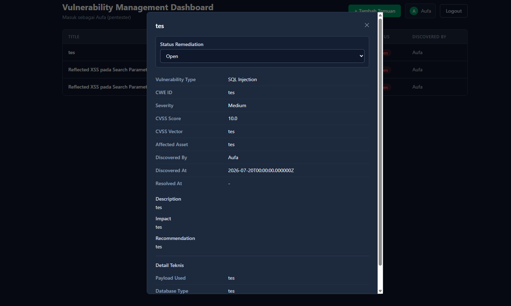
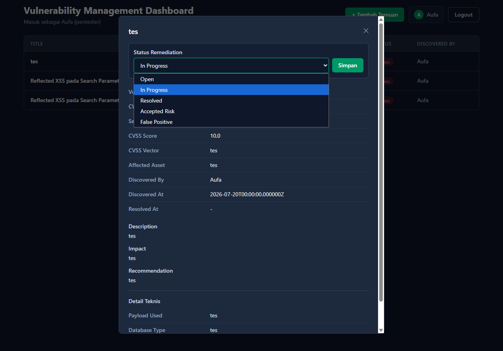
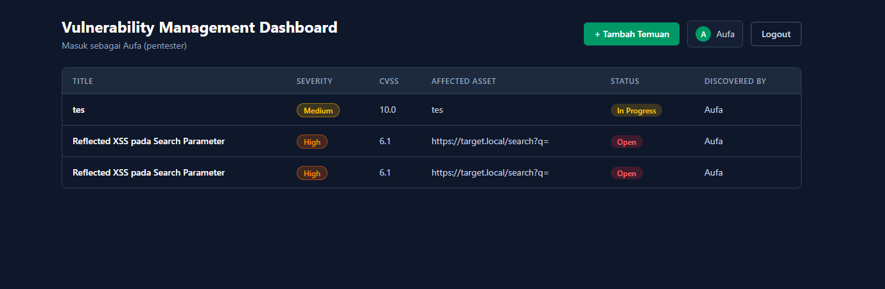
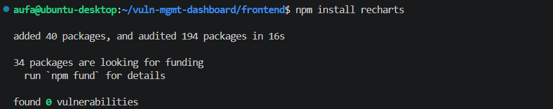
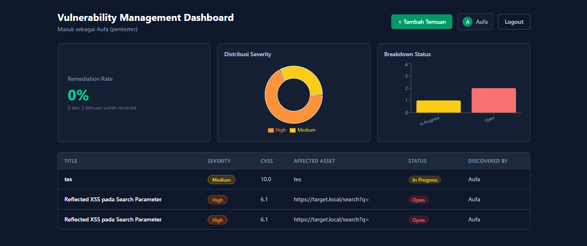
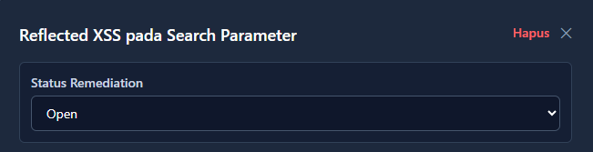
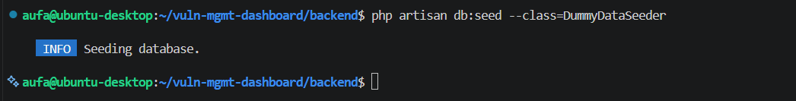
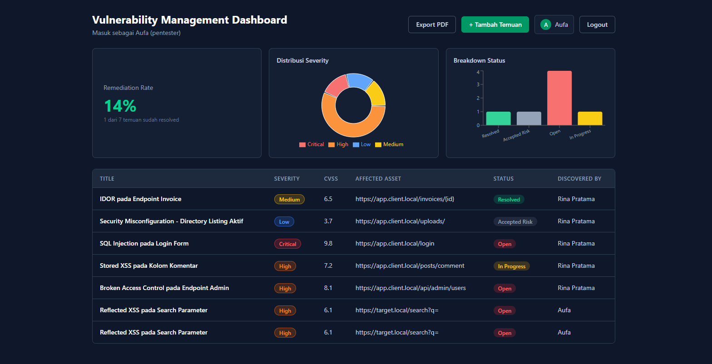

# Fase 6: Remediation, Chart, dan Data Contoh

[← Fase 5: Autentikasi](05-autentikasi.md) | [README](README.md) | [Fase 7: Export PDF →](07-export-pdf.md)

---

## 6.1 Update status remediation

- **Masalah:** status temuan harus bisa diubah dari UI (Open, In Progress, Resolved, Accepted Risk, False Positive), jangan sampai harus pakai `curl`.
- **Pengerjaan:**
  - Dropdown status di modal detail. Tombol Simpan cuma muncul kalau nilainya beda dari yang tersimpan, jadi ga ada request yang kebuang.
  - Kalau status diubah ke `Resolved` dan belum ada tanggal resolusi, request ikut ngirim `resolved_at` hari ini.
  - Setelah berhasil, modal nutup dan tabel di-refresh otomatis.
- **Hasil:** status berubah di tabel (contohnya jadi `In Progress` dengan badge kuning) tanpa reload halaman.







---

## 6.2 Chart di dashboard

- **Masalah:** tabel doang susah buat ngeliat gambaran besar risikonya.
- **Pengerjaan:** pakai Recharts. Tiga widget dihitung langsung di browser dari data yang udah di-fetch, jadi ga perlu endpoint baru: kartu remediation rate, donut chart distribusi severity, dan bar chart breakdown status.
- **Hasil:** dashboard nampilin ringkasan di atas tabel.
- **Kesimpulan:** chart trend over time ada di spesifikasi awal tapi belum aku kerjain, karena itu butuh data per tanggal yang belum aku siapin.

```jsx
const resolvedCount = vulnerabilities.filter((v) => v.status === 'Resolved').length
const remediationRate = ((resolvedCount / vulnerabilities.length) * 100).toFixed(0)
```





---

## 6.3 Hapus temuan

- **Pengerjaan:** tombol Hapus di modal detail yang manggil `DELETE /api/vulnerabilities/{id}`. Sebelum jalan, browser nampilin konfirmasi biar ga kepencet ga sengaja.
- **Hasil:** temuan hilang dari tabel setelah dikonfirmasi. Dengan ini create, read, update, dan delete semuanya bisa dari UI.



---

## 6.4 Data contoh dengan seeder

- **Masalah:** data buat tes isinya banyak yang cuma "tes", jadi dashboard dan PDF keliatan kosong maknanya.
- **Pengerjaan:** `DummyDataSeeder` bikin tiga user (satu per role) dan lima temuan realistis lintas kategori, severity, dan status (SQL Injection, Stored XSS, Broken Access Control, IDOR, Security Misconfiguration). Pakai `firstOrCreate` supaya seeder bisa dijalanin ulang tanpa user dobel.
- **Hasil:** dashboard punya 7 temuan dengan severity dan status yang beragam, dan remediation rate naik jadi 14%.





---

[← Fase 5: Autentikasi](05-autentikasi.md) | [README](README.md) | [Fase 7: Export PDF →](07-export-pdf.md)
