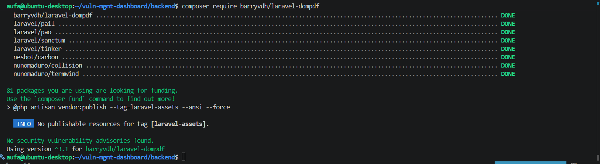
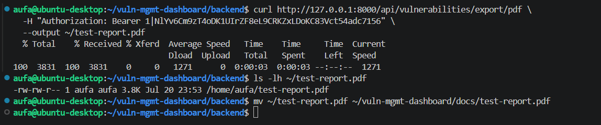
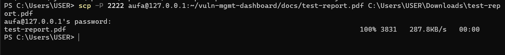
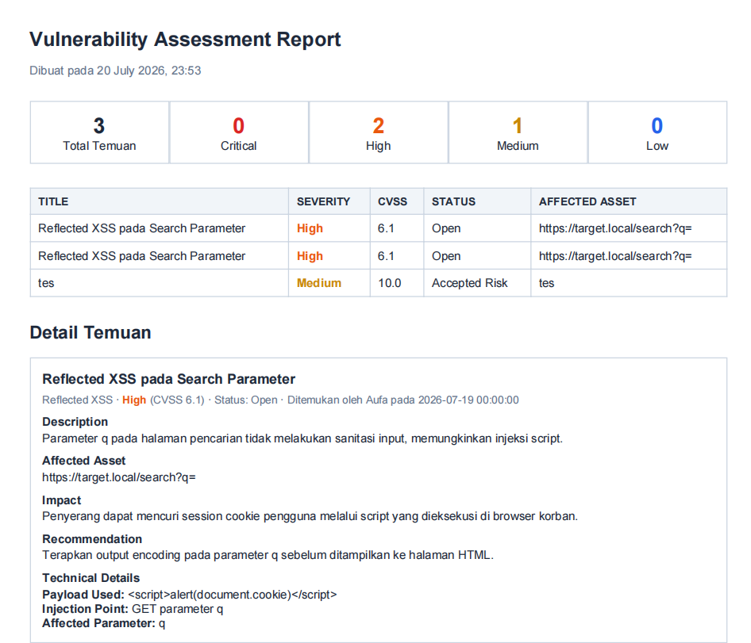
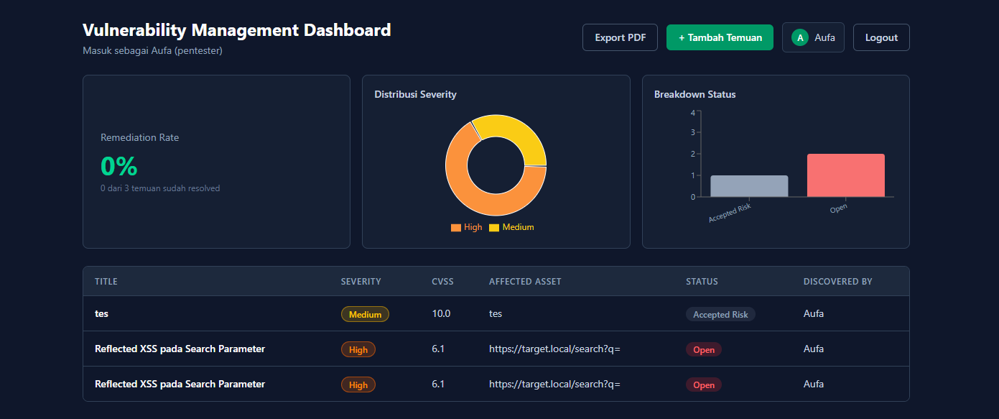
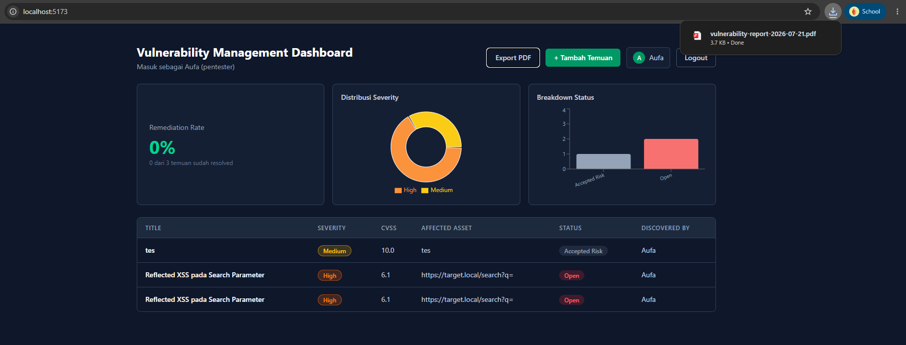

# Fase 7: Export PDF

[← Fase 6: Remediation, Chart, dan Data Contoh](06-remediation-chart-data-contoh.md) | [README](README.md) | [Fase 8: Keamanan dan Penutup →](08-keamanan-dan-penutup.md)

---

## 7.1 Generate PDF di backend

- **Masalah:** spesifikasi awal minta laporan otomatis yang formatnya mirip pentest report.
- **Pengerjaan:**
  - Install `barryvdh/laravel-dompdf`.
  - Template Blade `reports/vulnerability-report` isinya kotak ringkasan (total dan jumlah per severity), tabel temuan, lalu detail tiap temuan lengkap dengan `technical_details`.
  - Temuan diurutkan dari Critical sampai Info pakai `orderByRaw("FIELD(...)")`, jadi yang paling serius muncul duluan.
  - Route `export/pdf` harus didaftarin sebelum `apiResource`. Kalau kebalik, Laravel baca kata `export` sebagai ID temuan.
- **Hasil:** endpoint `GET /api/vulnerabilities/export/pdf` balikin file PDF.

```php
public function exportPdf()
{
    $vulnerabilities = Vulnerability::with(['discoveredBy', 'assignedTo'])
        ->orderByRaw("FIELD(severity, 'Critical', 'High', 'Medium', 'Low', 'Info')")
        ->get();

    $pdf = \Barryvdh\DomPDF\Facade\Pdf::loadView('reports.vulnerability-report', [
        'vulnerabilities' => $vulnerabilities,
        'generatedAt' => now()->format('d F Y, H:i'),
    ]);

    return $pdf->download('vulnerability-report-' . now()->format('Y-m-d') . '.pdf');
}
```



---

## 7.2 Tes endpoint dan cek isi PDF

- **Masalah:** aku mau mastiin PDF-nya valid dan isinya sesuai sebelum nyambungin ke tombol.
- **Pengerjaan:**
  - Sempat gagal konek ke port 8000 pas `curl` pertama, karena `php artisan serve` ternyata udah mati. Setelah dinyalain lagi, `curl` dengan token berhasil download file.
  - File dicopy ke Windows pakai `scp` (port 2222) supaya bisa dibuka pakai PDF reader biasa.
- **Hasil:** PDF ukuran sekitar 3,8 KB. Isinya kotak ringkasan, tabel, dan detail tiap temuan, urut dari severity paling tinggi.







---

## 7.3 Tombol di React

- **Masalah:** response endpoint ini file biner, bukan JSON, jadi ga bisa diproses kayak fetch yang lain.
- **Pengerjaan:** request dibaca pakai `.blob()`, lalu dibikin link download sementara yang diklik lewat kode buat nge-trigger dialog simpan bawaan browser. Header Authorization tetap dikirim.
- **Hasil:** tombol Export PDF di header dashboard langsung download `vulnerability-report-<tanggal>.pdf` dari browser.
- **Kesimpulan:** alur dari klik sampai file jadi sekarang ga perlu langkah manual lagi.





---

[← Fase 6: Remediation, Chart, dan Data Contoh](06-remediation-chart-data-contoh.md) | [README](README.md) | [Fase 8: Keamanan dan Penutup →](08-keamanan-dan-penutup.md)
